  <picture>
    <source media="(prefers-color-scheme: light)" srcset="header-light.svg"/>
    <source media="(prefers-color-scheme: dark)" srcset="header.svg"/>
    
  </picture>

  <a href="https://daminov.net">Website</a>
  &nbsp;&middot;&nbsp;
  <a href="https://t.me/tim_daminov">Telegram</a>
  &nbsp;&middot;&nbsp;
  <a href="mailto:timur.daminov77@gmail.com">Email</a>

## About

I'm Timur Daminov, a product engineer based in Innopolis. I've worked with JavaScript since 2022, starting with freelance websites and moving into web applications, backend systems and flight simulator integrations.

I turn product requirements into working software: interfaces, API contracts, data models and the integration between them. My work includes handling concurrent requests, keeping state consistent across clients, and making operations recoverable when a connection or process fails.

## Selected work

### TapFlight / RU_PMDG

**Product Engineer · December 2025 – present**

An ecosystem for flight simulator users, with a desktop application, web services and in-simulator add-ons.

- **In-simulator panels.** Built MSFS 2020/2024 panels for crew controls, radar, checklists and emergency actions, packaged together as a Community add-on.
- **Two-way synchronization.** Connected the panels to the desktop application through SimConnect, a WASM bridge and LVARs. Both interfaces use the same application state and command handlers.
- **Bridge protocol.** Used change-based updates, periodic snapshots, heartbeats and command acknowledgements. Access is limited to TapFlight variables; repeated command sequence numbers are not executed again.
- **Realtime messaging.** Separated WebSocket subscription lifecycle from notification preferences to avoid unnecessary reconnects. Added PostgreSQL-backed message deduplication so concurrent retries return the same stored message.

**Stack:** TypeScript, JavaScript, React, Rust/Tauri, Go, PostgreSQL, WebSockets, MSFS SDK, SimConnect.

[TapFlight](https://tapflight.app)

### International Orthodontic Center MChJ

**Product Engineer · September 2024 – June 2026**

A platform for clinics, specialists and patients. Worked on this project and TapFlight in parallel from December 2025 to June 2026.

- **Consistent rate limits.** Implemented atomic minute/hour counters with Redis Lua scripts and Redis server time, keeping limits consistent across backend instances.
- **Authorization on retries.** Rechecked access to the appointment before returning a stored command result, so idempotent replay does not bypass changed permissions.
- **Committed-state updates.** Used PostgreSQL LISTEN/NOTIFY and SSE to refresh appointment data after transaction commit. Subscriptions are scoped to a clinic and bounded by connection limits.
- **Data isolation.** Combined clinic scope, permissions and record-level checks for access to appointments.

**Stack:** TypeScript, React, Go, PostgreSQL, Redis, REST APIs, SSE.

### Freelance web development

**Web Developer · 2022 – 2024**

Built landing pages and websites, then expanded into client applications and backend development.

- Developed interfaces with JavaScript, TypeScript, React and Vue, including user interactions and server integration.
- Worked on Node.js services and PostgreSQL-backed data storage.
- Took projects from client requirements through implementation and feedback.

**Stack:** JavaScript, TypeScript, Node.js, PostgreSQL, React, Vue, Python, Go, HTML, CSS.

## Engineering focus

- **Web:** JavaScript, TypeScript, React, Vue, HTML, CSS.
- **Backend and data:** Node.js, Go, Python, PostgreSQL, MySQL/MariaDB, Redis, SQL, REST APIs, WebSockets.
- **Desktop and simulation:** Rust/Tauri, MSFS SDK, SimConnect, WASM bridges.
- **Reliability:** transactions, idempotency, access control, concurrency, integration testing and recovery.
- **Diagnostics:** event-loop delay, heap usage, latency percentiles, SQL metrics and Sentry.
- **Tools:** Git, Docker, Playwright.

## Education and languages

**Innopolis University** · Computer Science and Engineering, bachelor's degree in progress. Expected graduation: **2028**.

Russian: native. English: C1.

## Contact

- Website: [daminov.net](https://daminov.net)
- Telegram: [@tim_daminov](https://t.me/tim_daminov)
- Email: [timur.daminov77@gmail.com](mailto:timur.daminov77@gmail.com)

GitHub activity

  

  

  

